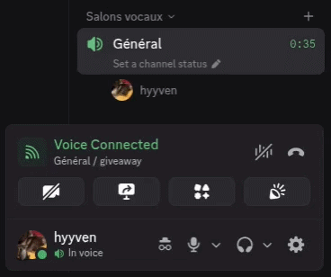

# 30 October 2026: STILL WORKING but the logo on the "plugin user" side is not showing. Other people still see it though. 

# Vencord-FakeDeafen
Adds a button and a keybind to fake deafen yourself in voice channels. When enabled, you appear deafened and/or muted to others, but you can still hear and speak.

Credit to [yofukashino](https://github.com/yofukashino) and [SiriusBYT](https://github.com/SiriusBYT) who did it but for an other discord client

# How to Install

tutorial: https://www.youtube.com/watch?v=mTjeZ2nkJcg

# Known issues

The button can, in some conditions that I don't really understand, fail to appear; if so, just press ctrl+shift+q

# Nota de esta copia

Incluye un parche **local** (no está en el repo de hyyven) para que el icono de sordo tambien se
vea en tu propio lado:

- Discord dibuja el estado de TU usuario desde `MediaEngineStore.isSelfDeaf()`, no desde el estado
  que llega por el gateway. Por eso el fake deafen solo lo veian los demas.
- El parche envuelve ese getter mientras el fake esta activo y devuelve `true`.
- Es **solo visual**: no toca el motor de audio, sigues oyendo y hablando.
- Se puede desactivar con el ajuste *"show the deafen icon on your own side"* (`showOwnIcon`).
